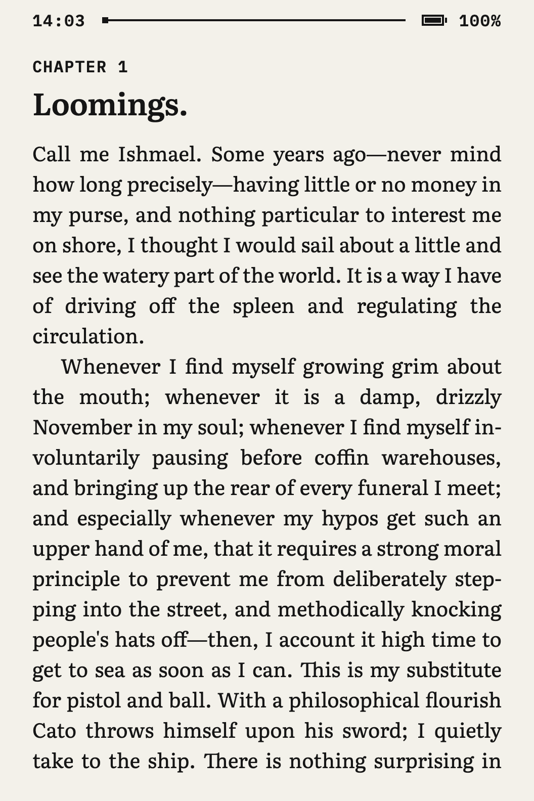
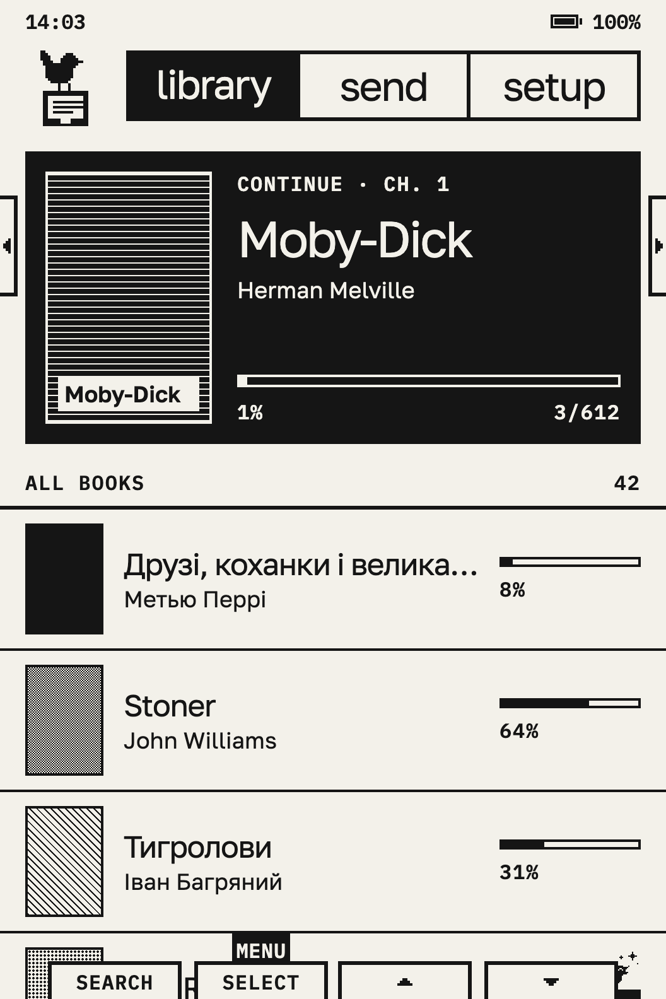
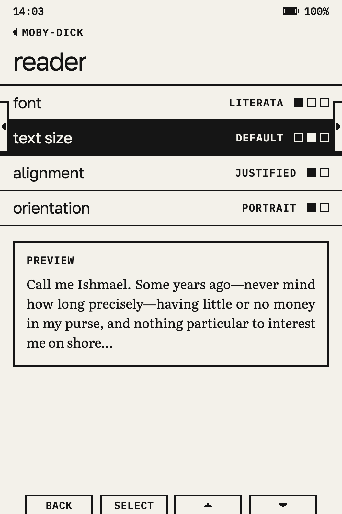
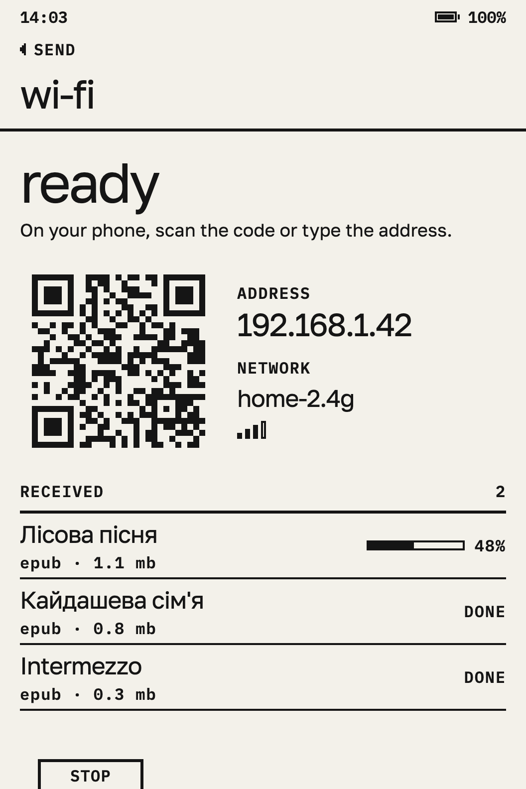
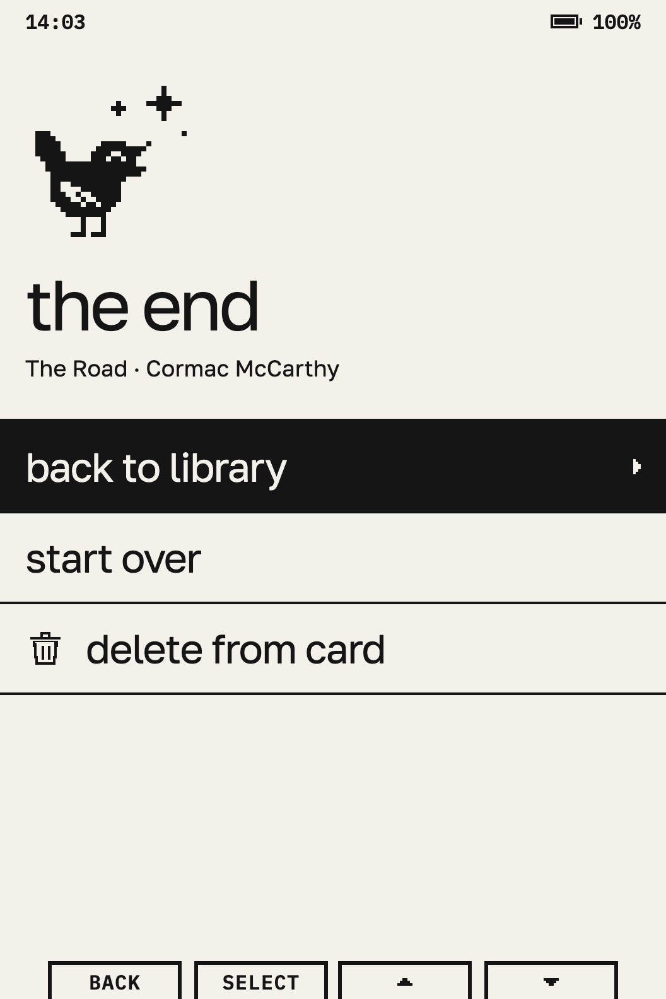
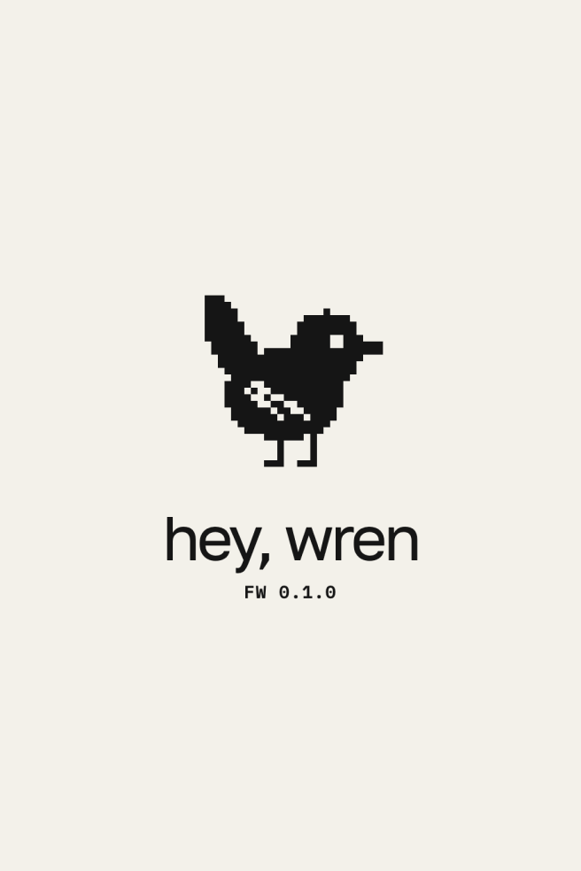

<h1 align="center">hey, wren</h1>

<p align="center">
  A quieter way to read on your Xteink.<br>
  <a href="https://gdaniil.github.io/wren-firmware/"><b>Install from your browser →</b></a>
</p>

<p align="center">
  
  
  
</p>

Wren is reading firmware for Xteink e-ink readers. It keeps the engine of
[CrossPoint Reader](https://github.com/crosspoint-reader/crosspoint-reader) and
redraws everything you look at: the page, the library, the menus. Fewer screens, fewer
settings, more care in each one.

## What's different

**Books, ready to read.** Good type and spacing are set before you open a book.
Literata, Golos and Bitter, sized for small e-ink screens, with hyphenation and
real chapter headings.

**Your library is home.** Turn the reader on and your current book is on top, the rest
of the shelf below. Send and setup are one tab away.

**Fewer settings.** Font, size, alignment, orientation. That's it.

**Send books your way.** Wi-Fi, hotspot, Calibre or the SD card. The apps you already
use with CrossPoint keep working: Send to X4, CrossPoint Sync and the built-in web page.

**Safe to try.** Your books stay on the card. CrossPoint is one install away.

<p align="center">
  
  
  
</p>

## Install

1. Open **[gdaniil.github.io/wren-firmware](https://gdaniil.github.io/wren-firmware/)**
   in Chrome or Edge on a computer.
2. Plug in your reader with a data cable and wake it up.
   On the X3, the 2-pin cable only charges: use the 4-pin one.
3. Pick your model and press **install wren**.
4. Unplug, press the power button, read.

For all three reading fonts, download `fonts.zip` from the same page and copy the
`fonts` folder to the root of your SD card.

The installer writes only the app slot. The bootloader, partition table and your
settings stay as they were. Details: [web-flasher/README.md](web-flasher/README.md).

## Readers

| Model | Chip | Status |
| --- | --- | --- |
| Xteink X3 | ESP32-C3 | Tested on hardware ([log](docs/ours/HARDWARE_LOG.md)) |
| Xteink X4 | ESP32-C3 | Builds, not tested on hardware |
| Xteink X4 Classic | ESP32-S3 | Builds, not tested on hardware |
| Xteink X4 Pro | ESP32-S3 | Builds, not tested on hardware |

Have an X4, X4 Classic or X4 Pro? An issue with a photo of what you see helps a lot.

## Build

Wren builds like CrossPoint. Clone with submodules, then from the repo root:

```bash
pio run -e default    # X3 and X4
pio run -e x4c        # X4 Classic
pio run -e x4pro      # X4 Pro
pio run -t unit-tests
```

Toolchain setup, checks and debugging:
[docs/contributing/getting-started.md](docs/contributing/getting-started.md).
Our design notes and plans: [docs/ours/](docs/ours/).

## Credits

Wren stands on the work of the [CrossPoint Reader](https://github.com/crosspoint-reader/crosspoint-reader)
community, 300+ contributors whose history this repository keeps, and the
[FreeInk SDK](https://github.com/Free-Ink/freeink-sdk). If you like Wren, consider
[funding CrossPoint contributors](https://app.royalty.dev/crosspoint-reader/crosspoint-reader).

The source code is under the [MIT License](LICENSE). The built firmware is GPLv3,
because it includes wolfSSL. Other third-party parts keep their own licenses: see
[licenses/](licenses/README.md).
Not affiliated with Xteink.
